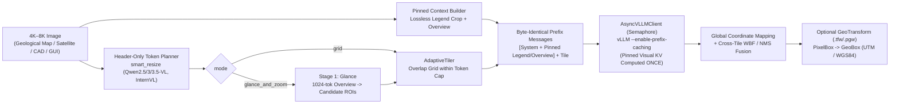

<div align="center">

# `vlm-zoom`

**High-resolution adaptive tiling, exact visual token budgeting, pinned-context prefix caching, and Glance-and-Zoom inference for VLMs on vLLM.**

[](https://www.python.org/downloads/)
[](tests/)
[](https://github.com/astral-sh/ruff)
[](LICENSE)

English | [简体中文](README_CN.md)

</div>

---

Modern Vision-Language Models (`Qwen2.5-VL`, `Qwen3-VL`, `Qwen3.5`, `InternVL`) hit a hard wall on ultra-high-resolution imagery — **regional geological maps, satellite/remote-sensing orthophotos, engineering CAD blueprints, 4K/8K GUI screenshots, and dense technical sheets**:

- **Downscale to fit a 1024-token budget** -> tiny stratigraphic codes (`J3`, `K1`, `gamma5`), strike/dip numbers, small targets, and dense text turn into unreadable pixel mush.
- **Send raw 4K–8K pixels directly** -> visual tokens and KV cache explode (or trigger silent server-side resizing), while naive tiling loses global context and the map legend.

**`vlm-zoom`** solves both with a lightweight, zero-PyTorch, pure-Python library built specifically for **vLLM / SGLang** multimodal serving.


---

## Why `vlm-zoom`?

| Capability | Naive Downscaling | Naive Static Grid | **`vlm-zoom`** |
|---|---|---|---|
| **Tiny text / small targets on 4K–8K images** | Destroyed (~0.2x scale) | Preserved | **Preserved (~0.85–1.0x native scale)** |
| **Exact visual token budget per VLM family** | Guesswork | Guesswork | **Exact `smart_resize` (`Qwen2/2.5/3/3.5-VL`) & `InternVL` math** |
| **Global context & Map Legend retention** | Kept (blurry) | **Lost on tiles!** | **Pinned Context (`legend_box` / `pin_overview`)** |
| **vLLM KV Cache reuse across tiles** | N/A | None | **Byte-identical prefix -> `--enable-prefix-caching` KV reuse** |
| **Skip empty background regions** | No | No | **Two-stage `glance_and_zoom` ROI focusing** |
| **Duplicate boxes on tile seams** | N/A | Raw duplicates | **Cross-tile Weighted Boxes Fusion (WBF) & NMS** |
| **Geospatial coordinates (GeoTIFF / maps)** | Pixels only | Pixels only | **Pure-Python ESRI World File (`.tfw`/`.pgw`/`.jgw`) projection** |
| **Heavy dependencies (PyTorch / GDAL)** | Often required | Often required | **Zero — only `Pillow`, `numpy`, `httpx`** |

---

## Architecture



### The Prefix-Caching Trick for Geological Maps & CAD Drawings

When zooming into a 1:50,000 geological map or engineering schematic, every zoomed tile needs the **Map Legend** to know what color/pattern corresponds to `J3 Shale`, `gamma5 Granite`, or `Major Fault F1`.

`vlm-zoom` constructs every tile's OpenAI-compatible message list with a **strictly byte-identical prefix** (`system` prompt + lossless PNG legend crop + optional global overview) before the tile-specific crop. When serving on vLLM with `--enable-prefix-caching`, vLLM hashes the shared multimodal prefix and computes its visual KV cache **once**, reusing it across all concurrent tiles (saving `(N - 1) * pinned_tokens` of prefill work).

---

## Installation

```bash
pip install -e .
# With dev tools (pytest, pytest-asyncio, ruff)
pip install -e ".[dev]"
```

---

## Quickstart

### 1. Header-Only Budget Inspection (Zero Pixel Decode, Zero GPU)

```bash
vlm-zoom inspect path/to/geological_map.tif --model Qwen/Qwen3-VL-4B-Instruct
```

Or generate the 4.8K geological map comparison visual yourself:

```bash
vlm-zoom demo --out assets/geological_map_demo.png
```

### 2. Python API: Glance-and-Zoom + Pinned Legend + World-File GeoTransform

Start vLLM with Automatic Prefix Caching enabled:

```bash
vllm serve Qwen/Qwen3-VL-4B-Instruct \
    --enable-prefix-caching \
    --max-model-len 8192 \
    --limit-mm-per-prompt '{"image": 4}'
```

Run `vlm-zoom`:

```python
from vlm_zoom import AsyncVLLMClient, GeoTransform, PixelBox, ZoomEngine

client = AsyncVLLMClient(
    base_url="http://localhost:8000/v1",
    model="Qwen/Qwen3-VL-4B-Instruct",
    max_concurrency=8,
)

engine = ZoomEngine(
    client,
    model_family="qwen3_vl",
    max_tokens_per_tile=1024,
    overlap=0.15,
    fusion_method="wbf",
)

result = engine.run(
    "regional_geology_8k.png",
    prompt=(
        "Using the pinned Map Legend, detect all major faults and stratigraphic labels. "
        'Return JSON [{"label": str, "bbox_2d": [x1, y1, x2, y2], "score": float}].'
    ),
    mode="glance_and_zoom",          # or "grid" for exhaustive full-map sweep
    legend_box=PixelBox(3780, 120, 4750, 2880),  # pinned & KV-cached across all tiles!
    pin_overview=True,               # also pin compact global overview
    geo_transform=GeoTransform.from_world_file("regional_geology_8k.pgw", crs="EPSG:32650"),
)

print("Tiles run:", result.token_usage.num_tiles)
print("Est. prefix tokens saved via KV cache:", result.token_usage.estimated_prefix_tokens_saved)
for det, gbox in result.geo_detections:
    print(det.label, det.box.to_int_tuple(), "->", (gbox.min_x, gbox.min_y, gbox.max_x, gbox.max_y))
```

### 3. CLI Usage

```bash
# Inspect visual token budget & optimal tiling grid (JSON output for pipelines)
vlm-zoom inspect map_8k.png --model qwen3_vl --max-tokens-per-tile 1024 --json

# Export budget-resized tiles + lossless pinned_legend.png + manifest.json
vlm-zoom tile map_8k.png --out-dir ./tiles_out --legend-box 3780,120,4750,2880

# End-to-end concurrent inference against a live vLLM endpoint
vlm-zoom run map_8k.png \
    --base-url http://localhost:8000/v1 \
    --model Qwen/Qwen3-VL-4B-Instruct \
    --mode glance_and_zoom \
    --legend-box 3780,120,4750,2880 \
    --pin-overview \
    --world-file map_8k.pgw \
    --prompt "Detect all fault labels and ore veins as JSON bbox_2d."
```

---

## Supported VLM Tokenization Specs

| Model Family | Patch × Merge (`factor`) | Budgeting Model |
|---|---|---|
| `qwen2_vl` / `qwen2_5_vl` | `14 × 2 = 28` | Exact `smart_resize` |
| `qwen3_vl` / `qwen3_5` | `16 × 2 = 32` | Exact `smart_resize` |
| `internvl` | `448 px` dynamic tiles (`256 tok/tile`) + thumbnail | Exact aspect-ratio grid selector |
| `generic` | `14 × 2 = 28` (customizable via `VisionModelSpec`) | Exact `smart_resize` |

---

## Examples

- [`examples/geological_map_legend_zoom.py`](examples/geological_map_legend_zoom.py) — Regional geological map interpretation with Pinned Legend, vLLM prefix caching, cross-tile WBF, and UTM world-file projection.
- [`examples/remote_sensing_vllm_batch.py`](examples/remote_sensing_vllm_batch.py) — High-resolution satellite imagery Glance-and-Zoom detection workflow.

---

## Development

```bash
pytest -v
ruff check src tests examples
ruff format --check src tests examples
```

## License

Apache-2.0 — see [LICENSE](LICENSE).
