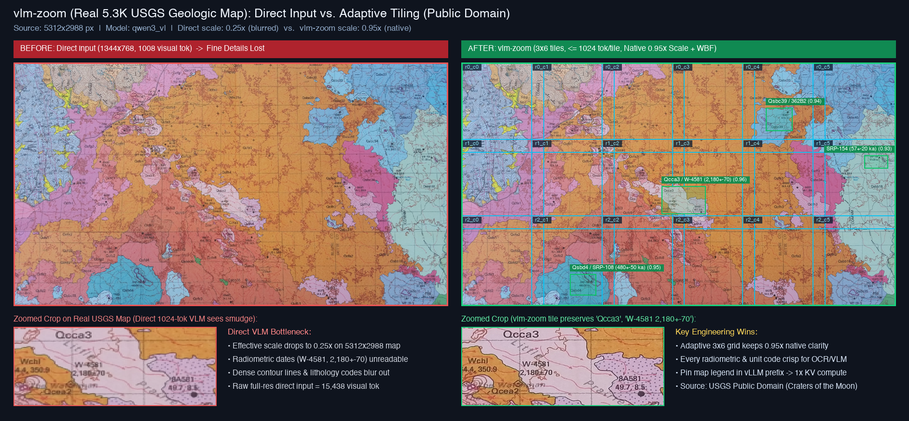
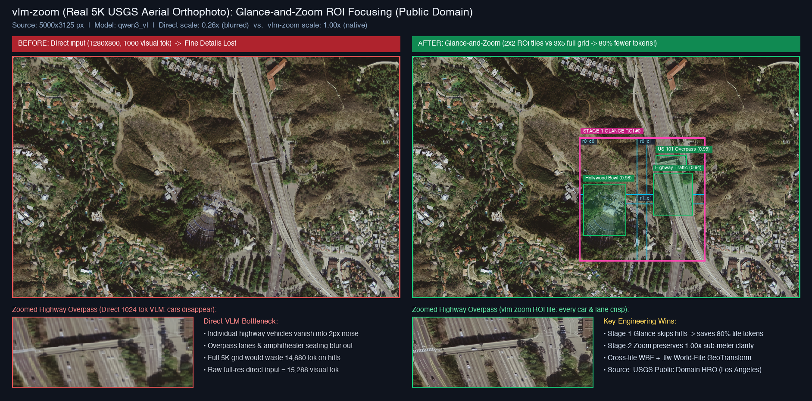
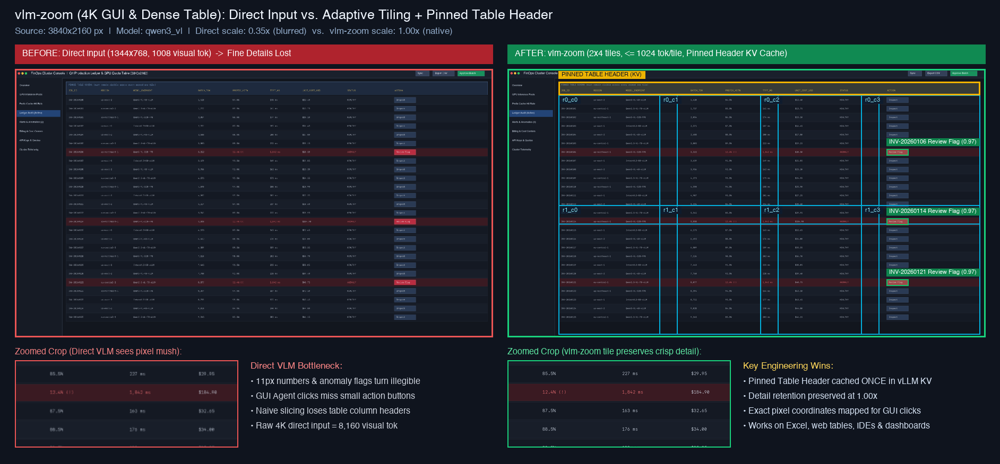
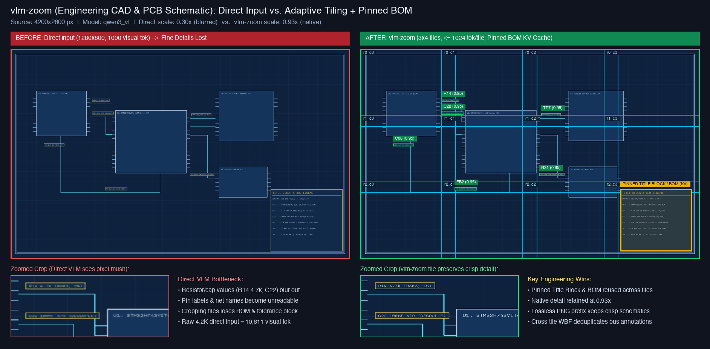
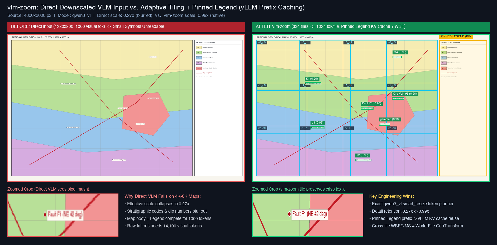
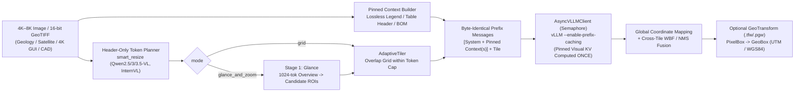

<div align="center">

# `vlm-zoom`

**High-resolution adaptive tiling, exact visual token budgeting, pinned-context prefix caching, and Glance-and-Zoom inference for VLMs on vLLM.**

[](https://www.python.org/downloads/)
[](tests/)
[](https://github.com/astral-sh/ruff)
[](LICENSE)

English | [简体中文](README_CN.md)

</div>

---

Modern Vision-Language Models (`Qwen2.5-VL`, `Qwen3-VL`, `Qwen3.5`, `InternVL`) hit a hard wall on ultra-high-resolution imagery — **regional geological maps, sub-meter satellite orthophotos, 4K desktop GUI screenshots, dense financial tables, and engineering CAD / PCB schematics**:

- **Downscale to fit a 1024-token budget** -> tiny radiometric dates, highway vehicles, 11px table numbers, GUI buttons, and resistor labels collapse into unreadable pixel mush (`0.25x` scale).
- **Send raw 4K–8K pixels directly** -> visual tokens explode to `10,000–15,000+` per image; while naive grid slicing **loses the Map Legend, Table Column Headers, or CAD Title Block** and creates duplicate boxes on tile seams.

**`vlm-zoom`** solves all of these in a lightweight, zero-PyTorch, zero-GDAL pure-Python library tailored for **vLLM / SGLang** multimodal serving.



---

## Multi-Domain Visual Gallery

### 1. Real 5K Aerial / Remote Sensing Orthophoto — Glance-and-Zoom (`80%` Fewer Tokens)
Stage 1 glances at a compact 1024-token overview to locate the active corridor (Hollywood Bowl + US-101 Freeway), skipping empty hills and zooming **only** into the candidate ROI at native `1.00x` resolution so individual highway vehicles and lane markings stay crisp.



### 2. 4K Desktop GUI Agents & Dense Financial Tables — Pinned Table Header (vLLM KV Cache)
Pins the **Table Column Header** and **Top Toolbar** as a byte-identical prefix across every zoomed tile. vLLM computes their visual KV cache **once** (`--enable-prefix-caching`), keeping 11px numbers readable and mapping exact global click coordinates for GUI Agents.



### 3. Engineering CAD & PCB Schematics — Pinned Title Block & BOM Legend
Pins the right-bottom **Title Block & BOM** losslessly as a shared prefix so every tile can cross-reference resistor/capacitor specs (`R14 4.7k`, `C22 100nF`, `TP7 SPI1_SCLK`) without losing micro-text clarity.



<details>
<summary><b>4. Geological Map with Pinned Stratigraphy Legend & UTM Projection (Click to expand)</b></summary>



</details>

---

## Why `vlm-zoom`?

| Capability | Naive Downscaling | Naive Static Grid | **`vlm-zoom`** |
|---|---|---|---|
| **Tiny text / small targets on 4K–8K images** | Destroyed (`0.25x`) | Preserved | **Preserved (`0.93x–1.00x` native scale)** |
| **Exact visual token budget per VLM family** | Guesswork | Guesswork | **Exact `smart_resize` (`Qwen2/2.5/3/3.5-VL`) & `InternVL`** |
| **Keep Map Legend / Table Header / BOM** | Blurry | **Lost on tiles!** | **Multi-region `pinned_boxes` / `legend_box` / `pin_overview`** |
| **vLLM KV Cache reuse across tiles** | N/A | None | **Byte-identical prefix -> `--enable-prefix-caching` reuse** |
| **Skip empty background regions** | No | No | **Two-stage `glance_and_zoom` (up to `80%` token savings)** |
| **Duplicate / clipped boxes on tile seams** | N/A | Duplicates | **Cross-tile Weighted Boxes Fusion (WBF) & Containment NMS** |
| **16-bit GeoTIFF / 100MP+ maps / World Files** | Crashes or black | Manual code | **Auto 2–98% stretch + 100MP+ safe + pure-Python `.tfw`/`.pgw`** |
| **Heavy dependencies (PyTorch / GDAL)** | Often required | Often required | **Zero — only `Pillow`, `numpy`, `httpx`** |

---

## Supported Image Formats & Inputs

- **Standard imagery**: `PNG`, `JPEG`, `WEBP`, `BMP`, 8-bit `TIFF`
- **Scientific / Remote Sensing imagery**: 16-bit integer (`uint16` / `I;16`) & 32-bit float (`float32` / `F`) single-band or multi-band GeoTIFFs & NumPy arrays (auto-normalized via robust 2%–98% percentile stretch with `NaN` handling)
- **Gigapixel / 100MP+ maps**: Safely lifts Pillow's decompression-bomb pixel ceiling for huge scanned geological maps and satellite mosaics
- **Georeferenced imagery**: Pure-Python ESRI World Files (`.tfw`, `.pgw`, `.jgw`, `.wld`) with full rotated-affine projection (`PixelBox` <-> `GeoBox`)

---

## Architecture



---

## Installation

```bash
pip install -e .
# With dev tools (pytest, pytest-asyncio, ruff)
pip install -e ".[dev]"
```

---

## Quickstart

### 1. Instant Visual Demos & Header-Only Inspection (Zero GPU)

```bash
# Generate before/after comparison demos for any scenario:
vlm-zoom demo --scenario geology --out assets/geological_map_demo.png
vlm-zoom demo --scenario gui     --out assets/demo_4k_gui_table.png
vlm-zoom demo --scenario cad     --out assets/demo_cad_pcb_schematic.png

# Inspect any 4K–8K image without decoding pixels:
vlm-zoom inspect path/to/map_8k.tif --model Qwen/Qwen3-VL-4B-Instruct --json
```

### 2. Python API: Multi-Region Pinned Context + Glance-and-Zoom on vLLM

Launch vLLM with Automatic Prefix Caching enabled:

```bash
vllm serve Qwen/Qwen3-VL-4B-Instruct \
    --enable-prefix-caching \
    --max-model-len 8192 \
    --limit-mm-per-prompt '{"image": 4}'
```

Run `vlm-zoom`:

```python
from vlm_zoom import AsyncVLLMClient, GeoTransform, PixelBox, ZoomEngine

client = AsyncVLLMClient(
    base_url="http://localhost:8000/v1",
    model="Qwen/Qwen3-VL-4B-Instruct",
    max_concurrency=8,
)

engine = ZoomEngine(
    client,
    model_family="qwen3_vl",
    max_tokens_per_tile=1024,
    overlap=0.15,
    fusion_method="wbf",
)

# Pin ANY shared region(s): Map Legend, Table Header, GUI Toolbar, or CAD Title Block!
result = engine.run(
    "regional_geology_8k.png",
    prompt=(
        "Using the pinned Map Legend, detect all major faults and stratigraphic labels. "
        'Return JSON [{"label": str, "bbox_2d": [x1, y1, x2, y2], "score": float}].'
    ),
    mode="glance_and_zoom",
    pinned_boxes={
        "Map Legend": PixelBox(3780, 120, 4750, 2880),
    },
    pin_overview=True,
    geo_transform=GeoTransform.from_world_file("regional_geology_8k.pgw", crs="EPSG:32650"),
)

print("Tiles run:", result.token_usage.num_tiles)
print("Est. prefix tokens saved via KV cache:", result.token_usage.estimated_prefix_tokens_saved)
for det, gbox in result.geo_detections:
    print(det.label, det.box.to_int_tuple(), "->", (gbox.min_x, gbox.min_y, gbox.max_x, gbox.max_y))
```

### 3. CLI Inference

```bash
vlm-zoom run screenshot_4k.png \
    --base-url http://localhost:8000/v1 \
    --model Qwen/Qwen3-VL-4B-Instruct \
    --mode grid \
    --pinned-box "Top Toolbar=0,0,3840,74" \
    --pinned-box "Table Header=412,104,3800,210" \
    --prompt "Locate every ANOMALY row's 'Review Flag' button as JSON bbox_2d."
```

---

## Supported VLM Tokenization Specs

| Model Family | Patch × Merge (`factor`) | Budgeting Model |
|---|---|---|
| `qwen2_vl` / `qwen2_5_vl` | `14 × 2 = 28` | Exact `smart_resize` |
| `qwen3_vl` / `qwen3_5` | `16 × 2 = 32` | Exact `smart_resize` |
| `internvl` | `448 px` dynamic tiles (`256 tok/tile`) + thumbnail | Exact aspect-ratio grid selector |
| `generic` | `14 × 2 = 28` (customizable via `VisionModelSpec`) | Exact `smart_resize` |

---

## Examples

- [`examples/geological_map_legend_zoom.py`](examples/geological_map_legend_zoom.py) — Geological map with Pinned Legend, vLLM prefix caching, cross-tile WBF, and UTM world-file projection.
- [`examples/remote_sensing_vllm_batch.py`](examples/remote_sensing_vllm_batch.py) — Satellite / aerial orthophoto Glance-and-Zoom detection workflow.
- [`examples/gui_agent_pinned_header.py`](examples/gui_agent_pinned_header.py) — 4K desktop GUI Agent & dense financial table with Pinned Column Header + Toolbar.
- [`examples/cad_schematic_bom_zoom.py`](examples/cad_schematic_bom_zoom.py) — Engineering CAD / PCB schematic inspection with Pinned Title Block & BOM Legend.

---

## Development & Credits

```bash
pytest -v
ruff check src tests examples
ruff format --check src tests examples
```

*Real-world showcase imagery in `assets/` is derived from Public Domain USGS datasets (Craters of the Moon Geologic Map & Los Angeles High-Resolution Orthoimagery via Wikimedia Commons).*

## License

Apache-2.0 — see [LICENSE](LICENSE).
