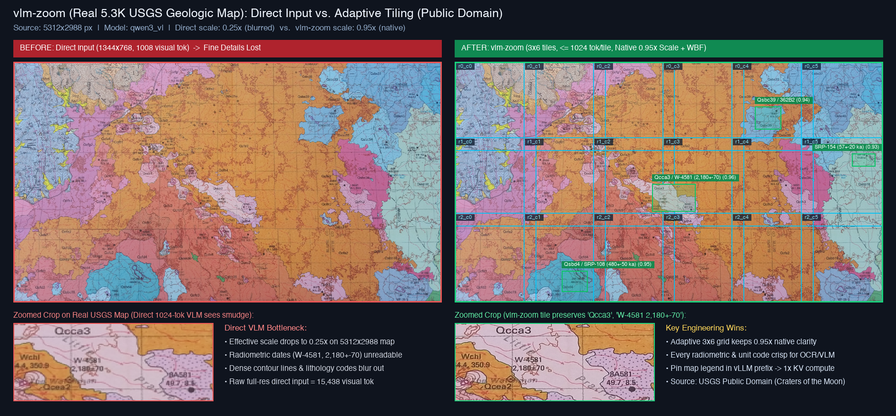
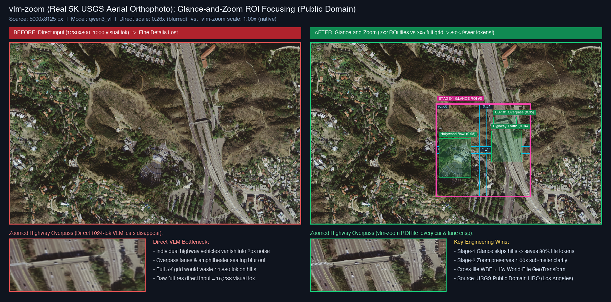
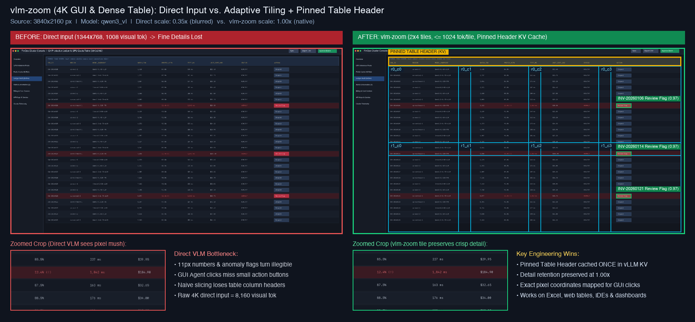
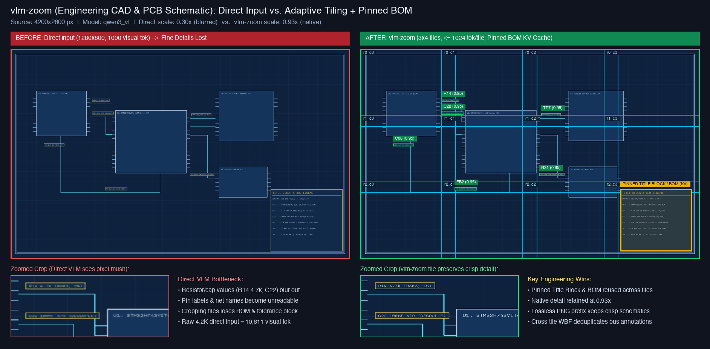
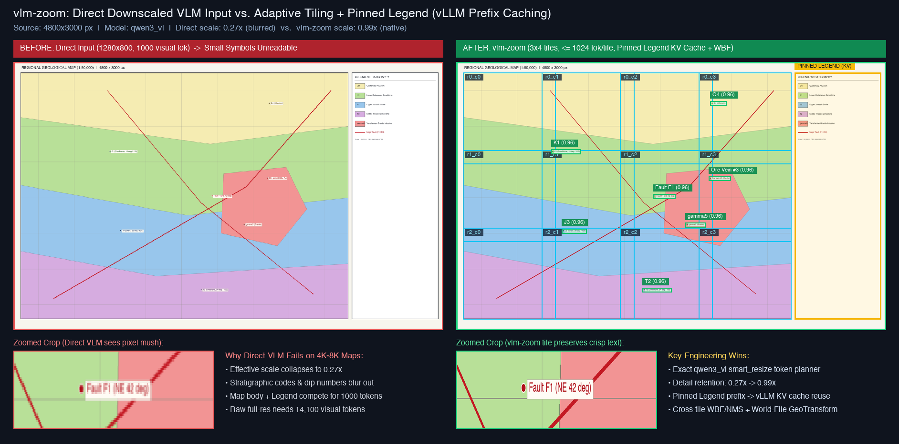

<div align="center">

# `vlm-zoom`

**面向 vLLM 多模态推理的高分辨率自适应切片、精确视觉 Token 预算规划、多区域固定前缀缓存（Prefix Caching）与 Glance-and-Zoom 引擎**

[](https://www.python.org/downloads/)
[](tests/)
[](https://github.com/astral-sh/ruff)
[](LICENSE)

[English](README.md) | 简体中文

</div>

---

当把 **4K–8K 区域地质图、亚米级遥感卫星正射影像、4K 桌面 GUI / 密集财报表格、工程 CAD / PCB 电路原理图** 输入 `Qwen2.5-VL / Qwen3-VL / Qwen3.5 / InternVL` 等多模态大模型时，几乎都会遇到两难问题：

- **整图压到 1024 token 预算**：地质图上的同位素年龄与地层代号、高速路上的车辆、表格里的 11px 数字、电路图电阻标号直接糊成马赛克（缩放比跌至 `0.25x`）；
- **原图直出推理**：单图动辄 `10,000–15,000+` 视觉 Token，KV Cache 和首字延迟瞬间爆炸；而简单网格切片又会**丢失图例、表格列名表头、CAD 标题栏/BOM**，并在切片交界产生大量重复检测框。

**`vlm-zoom`** 用纯 Python（零 PyTorch、零 GDAL 依赖）一站式解决以上痛点，专为 **vLLM / SGLang** 生产推理设计。



---

## 四大真实 / 高保真场景展示画廊

### 1. 真实 5K 亚米级航空遥感影像 — `Glance-and-Zoom` 省 `80%` 视觉 Token
Stage 1 先用 `1024` token 概览全图定位核心目标区（好莱坞碗剧场 + US-101 高速走廊），自动跳过大面积荒山背景，Stage 2 仅对 ROI 区域以 `1.00x` 原生分辨率放大切片，高速路上的每辆车与车道线纤毫毕现。



### 2. 4K 桌面 GUI Agent 与密集财务/监控表格 — 固定表头（Pinned Header + KV Cache）
把 **表格列名表头（Table Header）** 与 **顶部工具栏** 固定在所有切片请求的字节级一致前缀中：vLLM 只算 **1 次** 表头视觉 KV Cache 全切片复用，既保留 11px 异常数字的清晰度，又将点击按钮精确反算回 4K 全局坐标。



### 3. 工程 CAD / PCB 电路原理图 — 固定标题栏与 BOM 图例
将右下角 **标题栏与 BOM 清单** 无损固定在共享前缀中，每个高清切片都能对照 BOM 解读微小的器件参数（`R14 4.7k`、`C22 100nF`、`TP7 SPI1_SCLK`）。



<details>
<summary><b>4. 区域地质图固定图例（Pinned Legend）与 UTM 坐标投影（点击展开）</b></summary>



</details>

---

## 支持的图像格式与输入类型

- **常规图像**：`PNG`、`JPEG`、`WEBP`、`BMP`、8-bit `TIFF`
- **科研 / 遥感多波段图像**：支持 **16-bit 整型（`uint16` / `I;16`）与 32-bit 浮点（`float32` / `F`）单波段/多波段 GeoTIFF 与 NumPy 数组**，内置 2%–98% 鲁棒百分位对比度拉伸（含 `NaN` 容错），避免遥感原图直转 RGB 发黑
- **亿级像素（100MP+）超大图**：自动安全解除 Pillow 像素上限，避免超大地质图/卫星拼接图报错崩溃
- **地理配准影像**：纯 Python 解析 ESRI 世界文件（`.tfw` / `.pgw` / `.jgw` / `.wld`），支持含旋转项的完整仿射正反投影

---

## 快速开始

### 安装

```bash
pip install -e .
```

### 一键生成多场景对比图 & 零解码检查（无需 GPU）

```bash
# 生成不同领域的 Before/After 效果对比图
vlm-zoom demo --scenario geology --out assets/geological_map_demo.png
vlm-zoom demo --scenario gui     --out assets/demo_4k_gui_table.png
vlm-zoom demo --scenario cad     --out assets/demo_cad_pcb_schematic.png

# 零像素解码检查任意 4K–8K 大图的 Token 预算与最优切片方案
vlm-zoom inspect your_8k_map.tif --model Qwen/Qwen3-VL-4B-Instruct --json
```

### Python API：多区域固定前缀 + Glance-and-Zoom 对接 vLLM

先启动 vLLM 服务（开启 `--enable-prefix-caching`）：

```bash
vllm serve Qwen/Qwen3-VL-4B-Instruct \
    --enable-prefix-caching \
    --max-model-len 8192 \
    --limit-mm-per-prompt '{"image": 4}'
```

再调用 `ZoomEngine`：

```python
from vlm_zoom import AsyncVLLMClient, GeoTransform, PixelBox, ZoomEngine

client = AsyncVLLMClient(
    base_url="http://localhost:8000/v1",
    model="Qwen/Qwen3-VL-4B-Instruct",
    max_concurrency=8,
)

engine = ZoomEngine(
    client,
    model_family="qwen3_vl",
    max_tokens_per_tile=1024,
    overlap=0.15,
    fusion_method="wbf",
)

# 可固定任意共享上下文：地质图图例、表格列名表头、GUI 工具栏、CAD 标题栏/BOM！
result = engine.run(
    "regional_geology_8k.png",
    prompt=(
        "结合固定图例，定位图中所有断层注记与地层代号，"
        '输出 JSON [{"label": str, "bbox_2d": [x1, y1, x2, y2], "score": float}]。'
    ),
    mode="glance_and_zoom",
    pinned_boxes={"Map Legend": PixelBox(3780, 120, 4750, 2880)},
    pin_overview=True,
    geo_transform=GeoTransform.from_world_file("regional_geology_8k.pgw", crs="EPSG:32650"),
)

print("切片数:", result.token_usage.num_tiles)
print("Prefix Caching 节省的视觉 Token 估算:", result.token_usage.estimated_prefix_tokens_saved)
for det, gbox in result.geo_detections:
    print(det.label, det.box.to_int_tuple(), "->", gbox)
```

---

## 全部示例脚本

- 地质图固定图例 + UTM 投影：[`examples/geological_map_legend_zoom.py`](examples/geological_map_legend_zoom.py)
- 遥感大图 Glance-and-Zoom：[`examples/remote_sensing_vllm_batch.py`](examples/remote_sensing_vllm_batch.py)
- 4K GUI Agent & 密集表格固定表头：[`examples/gui_agent_pinned_header.py`](examples/gui_agent_pinned_header.py)
- 工程 CAD / PCB 原理图固定 BOM：[`examples/cad_schematic_bom_zoom.py`](examples/cad_schematic_bom_zoom.py)

---

## 开发测试与图源声明

```bash
pytest -v
ruff check src tests examples
ruff format --check src tests examples
```

*`assets/` 中的真实地质图与高分航拍样例源自美国地质调查局（USGS）Public Domain 公开数据（Wikimedia Commons）。*

## 开源协议

本项目基于 [Apache-2.0](LICENSE) 协议开源。
